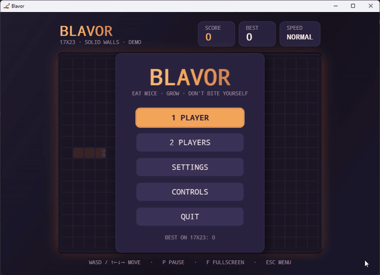
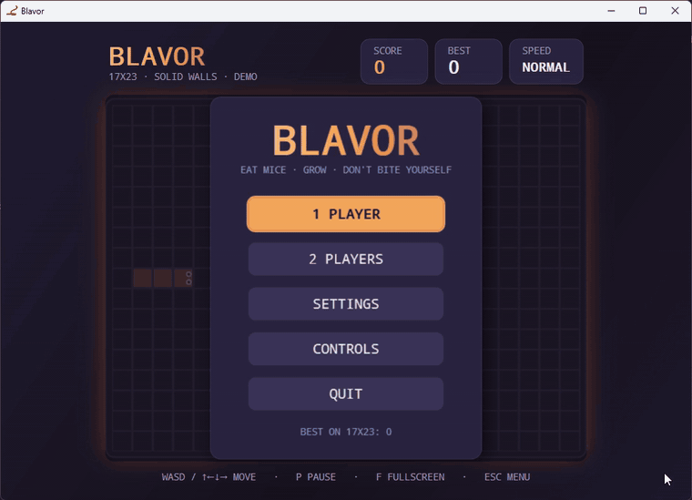
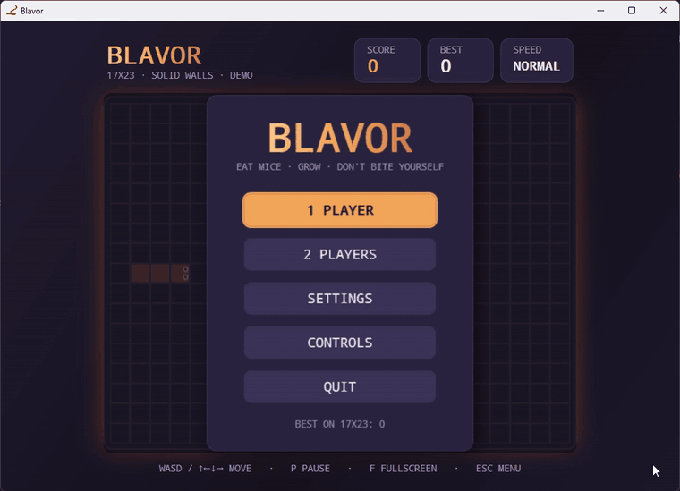
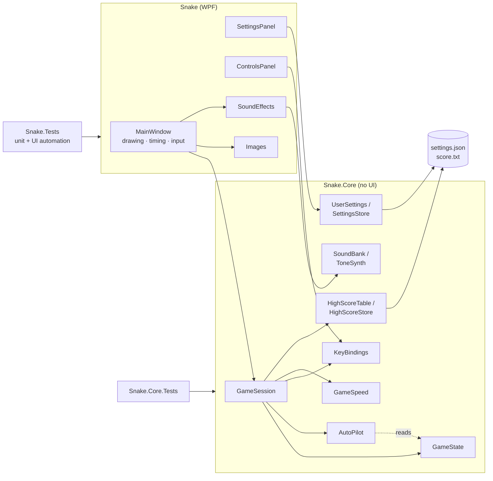
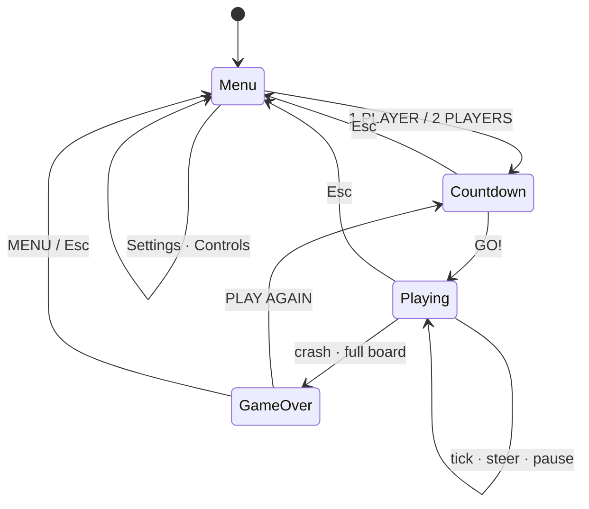
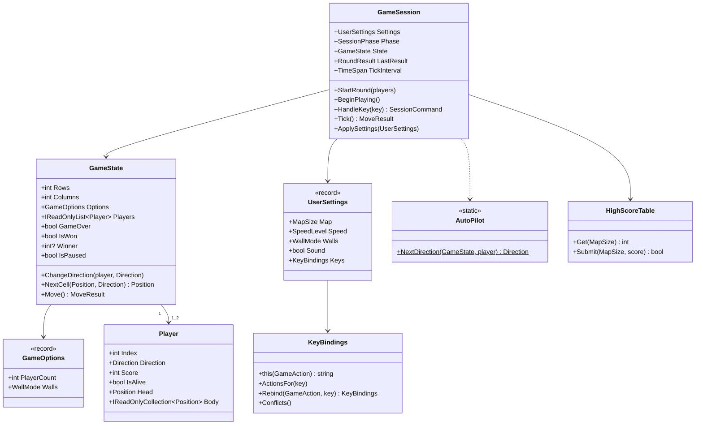
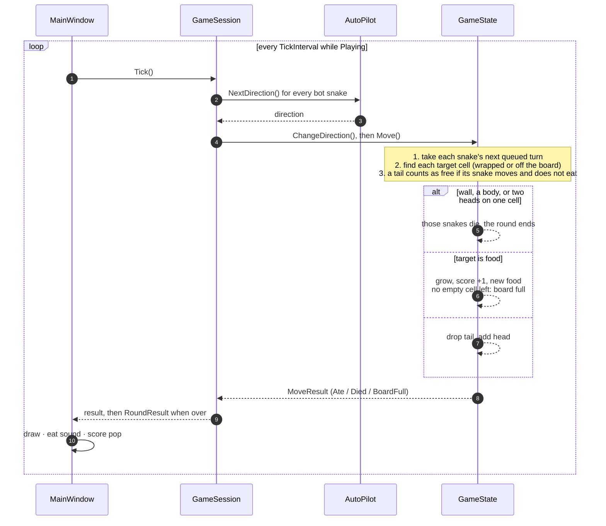

<div align="center">

# 🐍 Snake (Blavor)

[](https://github.com/pero-grubac/Snake/actions/workflows/ci.yml)


[](LICENCE.txt)

**The classic Snake for the Windows desktop, with a second player, wrap-around walls, rising speed, remappable keys and a record for every map size.**



</div>

---

## 📌 Project Overview

**Blavor** is a WPF take on the classic Snake. The snake (the *blavor*) moves around a grid and eats mice. Every mouse is one point and one more cell of snake. A round ends when a snake hits a wall or a body, and a single player wins by filling the whole board.

Two people can play on one keyboard, the walls can let the snake through to the other side, the game can speed up as the score grows, and every key can be changed. The map is adjustable from **15×15** to **25×25**, and each size keeps its own high score.

All rules live in a separate library with no UI code, so the game logic is covered by fast unit tests, and the window itself is covered by UI automation tests that drive the real app.

---

## ✨ Features

- 🎮 **Main menu** with 1 player, 2 players, settings and controls, usable with the mouse or the keyboard
- 👥 **Two players** on one keyboard: blue against orange, the last snake standing wins
- 🧱 **Two wall modes**: solid, or wrap-around, where leaving one edge brings you in on the other
- ⚡ **Four speeds**: slow, normal, fast, and *speeds up*, which gets faster with every mouse
- ⌨️ **Remappable controls** for both players, pause, screenshot and fullscreen, with swaps instead of clashes
- 🔊 **Sound effects** synthesised in code, so there are no audio files to ship. They can be switched off
- 🏆 **High score per map size**, saved between sessions
- ⏸️ **Pause** and 📸 **screenshots** while paused
- 🖥️ **Fullscreen**, with the whole layout scaling to the window
- 🤖 **Demo mode**: a bot plays every snake until you press a direction and take over
- 💾 **Settings remembered** between sessions

---

## 🕹️ Usage

### The menu

| Button | What it does |
|--------|--------------|
| **1 PLAYER** | Starts a single-player round |
| **2 PLAYERS** | Starts a round for two people on one keyboard |
| **SETTINGS** | Map size, speed, walls, sound |
| **CONTROLS** | Shows and changes every key |
| **QUIT** | Closes the game |

Use the mouse, or <kbd>Tab</kbd> / arrow keys and <kbd>Enter</kbd>. The best score for the current map size is shown under the buttons.

### Default controls

| Action | Player 1 | Player 2 |
|--------|----------|----------|
| Up | <kbd>W</kbd> | <kbd>↑</kbd> |
| Down | <kbd>S</kbd> | <kbd>↓</kbd> |
| Left | <kbd>A</kbd> | <kbd>←</kbd> |
| Right | <kbd>D</kbd> | <kbd>→</kbd> |

| Key | Action |
|-----|--------|
| <kbd>P</kbd> | Pause / resume |
| <kbd>S</kbd> *(while paused)* | Save a screenshot |
| <kbd>F</kbd> | Toggle fullscreen |
| <kbd>Esc</kbd> | Leave the round, or close a panel, and go back to the menu |

In a single-player game **both** key sets steer the snake, so WASD and the arrows both work. A snake can never turn straight back into itself, and two quick turns between ticks are both kept, so tight corners work.

### Playing a round

1. Choose **1 PLAYER** or **2 PLAYERS**. A **3 · 2 · 1 · GO!** countdown starts the round.
2. Steer towards the mouse. Each one is **+1 point** and one more cell.
3. The round ends when a snake hits a wall (in solid mode), its own body or the other snake. Two heads meeting on the same cell is a draw.
4. The game-over screen shows the result:
   - one player: **GAME OVER**, **NEW HIGHEST SCORE**, or **YOU WIN!** for a full board
   - two players: **PLAYER 1 WINS**, **PLAYER 2 WINS** or **DRAW**, with both scores
5. **PLAY AGAIN** starts the same mode again, and **MENU** goes back.

<div align="center">

</div>

### Settings

<div align="center">

</div>

| Setting | Options |
|---------|---------|
| Height / Width | 15 to 25 cells each |
| Speed | **Slow** (150 ms per step), **Normal** (100 ms), **Fast** (65 ms), **Speeds up** (140 ms, 4 ms faster per point, down to 55 ms) |
| Walls | **Solid** or **Wrap around** |
| Sound effects | On / off |

**SAVE** applies the settings at once, and **BACK** or <kbd>Esc</kbd> discards them.

### Changing controls

Open **CONTROLS**, click a key and press the new one. If that key already does something else, the two actions swap keys, so one key never does two things. Two keys are special:

- <kbd>Esc</kbd> always means "back" and cannot be bound.
- **Screenshot** may share a key with a movement key, because it only works while paused. That is why <kbd>S</kbd> is both "down" and "screenshot" by default.

**DEFAULTS** restores the original keys, and **DONE** saves them.

### Pause and screenshots

Press <kbd>P</kbd> to pause. A badge above the board shows the keys to resume and to take a screenshot. A screenshot is a PNG of the game window, without the badge.

### Demo mode

```powershell
dotnet run --project Snake -- --demo
```

Every snake is steered by a bot. It takes the shortest path to the mouse unless that would trap it, keeps away from the other snake's head, and otherwise heads for open space. Press a direction to **take over** that snake. Scores from demo rounds are never saved. The GIFs in this README were recorded in demo mode.

### Command-line options

| Option | Effect |
|--------|--------|
| `--demo` | Bots play until a player takes over, and scores are not saved |
| `--data-dir <path>` | Keeps settings and high scores in another folder, e.g. for testing |

### Where files are saved

| What | Location |
|------|----------|
| Settings | `%LOCALAPPDATA%\Blavor\settings.json` |
| High scores | `%LOCALAPPDATA%\Blavor\score.txt` (one `rows;columns;score` line per map) |
| Screenshots | `Pictures\Blavor\snake_yyyyMMddHHmmss.png` |

A damaged settings or score file never crashes the game: the broken parts fall back to defaults and the rest is kept.

---

## 🛠️ Tech Stack

| Technology | Usage |
|------------|-------|
| .NET 10 / C# 14 | Runtime and language, nullable reference types on, warnings as errors |
| WPF | Window, board rendering, animations, menu and panels |
| Snake.Core (class library) | Rules, session flow, bot, key bindings, settings, high scores, sound synthesis |
| System.Text.Json | Settings file |
| System.Media | Playing the synthesised WAV sounds |
| xUnit | Unit tests for both projects |
| UI Automation | End-to-end tests that drive the real game |
| coverlet | Code coverage in CI |
| GitHub Actions | CI: build and test |

---

## 📁 Repository Structure

```
Snake/
├── Snake/                      WPF application (Blavor)
│   ├── App.xaml(.cs)           Startup, --demo and --data-dir
│   ├── Theme.xaml              Colours, fonts, button / slider / switch styles
│   ├── MainWindow.xaml(.cs)    Board, header, menu, countdown, game over, input, timing
│   ├── SettingsPanel.xaml(.cs) Map size, speed, walls, sound
│   ├── ControlsPanel.xaml(.cs) Key bindings
│   ├── Images.cs               Sprites, with player two's recoloured at startup
│   ├── KeyNames.cs             Key labels (↑, SPACE…) and parsing
│   ├── SoundEffects.cs         Plays the sound cues
│   └── Slike/                  Sprites, icon and font
├── Snake.Core/                 Game logic, no UI
│   ├── GameState.cs            Board, snakes, food, collisions, wrap, win / lose / draw
│   ├── Player.cs               One snake: body, direction, turn buffer, score
│   ├── GameOptions.cs          Player count and wall mode for a round
│   ├── GameSession.cs          Menu → countdown → playing → game over, keys, bots, records
│   ├── GameSpeed.cs            Tick interval for each speed level
│   ├── AutoPilot.cs            The demo bot
│   ├── KeyBindings.cs          Actions, default keys, rebinding rules
│   ├── UserSettings.cs         Settings and their JSON store
│   ├── HighScoreTable.cs       Best score per map, parsing and serialising
│   ├── HighScoreStore.cs       Reading and writing the score file safely
│   ├── Sounds.cs               Tone synthesiser and sound cues
│   ├── MapSize.cs              Validated board size (15–25)
│   └── Direction.cs, Position.cs, GridValue.cs
├── Snake.Core.Tests/           Unit tests for Snake.Core
├── Snake.Tests/                Unit and UI automation tests for the WPF app
├── readme_assets/              GIFs for this README
├── .github/workflows/ci.yml    Build and test
├── Directory.Build.props       Settings shared by every project
├── global.json                 Pinned .NET SDK
└── Snake.sln
```

---

## 🚀 Installation

### Prerequisites
- Windows 10 or 11
- [.NET 10 SDK](https://dotnet.microsoft.com/download/dotnet/10.0)
- Optional: Visual Studio 2026 (with the .NET desktop workload) or JetBrains Rider

### 1. Clone the repository
```bash
git clone https://github.com/pero-grubac/Snake.git
cd Snake
```

### 2. Build and run
```bash
dotnet run --project Snake
```

In Visual Studio, open `Snake.sln`, set **Snake** as the startup project and press <kbd>F5</kbd>.

### 3. Run the tests
```bash
dotnet test --filter "Category!=UI"   # unit tests, under a second
dotnet test --filter "Category=UI"    # UI tests: start the real game, about 15 s
dotnet test                           # everything
```

The UI tests open game windows, so leave the mouse and keyboard alone while they run.

---

## 🏗️ Architecture

The solution has two layers. **Snake.Core** owns every rule and the whole flow of the game and has no idea WPF exists. The **Snake** app draws whatever state the core holds, turns key presses into calls on `GameSession`, and keeps time.



### Session flow



### Core model



### One tick

Every snake moves at the same time, so collisions are worked out for all of them before anything moves.



---

## 🧪 Testing

| Project | Tests | Runs in CI | Covers |
|---------|------:|:----------:|--------|
| `Snake.Core.Tests` | 118 | ✅ | All game logic |
| `Snake.Tests`, unit | 13 | ✅ | Key labels, every default key being a real WPF key, sprite recolouring |
| `Snake.Tests`, UI (`Category=UI`) | 5 | — | The real app: menu, saving settings, a round ending in game over, a two-player draw, the controls panel |

| Area | What is covered |
|------|-----------------|
| `GameState` | Start position, movement, eating, food never on a snake, walls, biting itself, the tail's cell, no reversing, the two-turn buffer, pause, nothing after game over, winning on a full board |
| Two players | Start positions, separate steering, wall and body crashes, head-on draws, who gets the food |
| Wrap-around | Passing through every edge, still dying on its own body |
| `GameSession` | Phases, keys ignored during the countdown, both key sets in single player, the S key's two jobs, Esc, rebound keys, results, records, demo mode and taking over, speed, settings applied on the menu |
| `KeyBindings` | Defaults without clashes, swapping, the reserved Esc key, refusing a swap that would still clash, loading saved keys |
| `SettingsStore` / high scores | Round trips, broken files, impossible values, no temporary files left behind |
| `GameSpeed` / sounds | Interval per level and per score; valid WAV headers and lengths for every cue |
| `AutoPilot` | Heading for food, never reversing, avoiding walls, playing whole seeded games |

Food placement is deterministic in tests: `GameState` accepts a `Random`, and the tests pass a scripted one that puts each mouse exactly where the scenario needs it.

---

## ⚙️ CI

[`ci.yml`](.github/workflows/ci.yml) runs on pushes and pull requests to `master`, or by hand. It restores, builds with warnings as errors, runs every test except the UI ones with coverage, and uploads the results.

It skips changes that cannot affect the build: Markdown files, `readme_assets/`, the license, `.gitignore` and `.gitattributes`. A newer push to the same branch cancels the run already in progress.

---

## 🧭 Design Decisions

- **The window is a view.** `GameSession` owns the flow (menu, countdown, playing, game over), the keys, the bots and the records; `GameState` owns the rules. The window only draws, keeps time and plays sounds, so nearly everything is tested without starting WPF.
- **Simultaneous moves.** With two snakes, every target cell is worked out before anyone moves. That makes head-on crashes and chasing the other snake's tail behave the same no matter which player is first in the list.
- **Injected randomness.** Food placement is the only random thing in the game, and `GameState` takes the `Random` it uses, so every scenario can be replayed in a test.
- **Keys as names, not WPF types.** `KeyBindings` stores key names like `"W"` and `"Up"`, so the rules about keys live in the core and are tested there. The app only parses them.
- **Bindings never clash.** Rebinding to a taken key swaps the two actions. A rebind that would still leave a clash is refused, and a hand-edited settings file with clashes falls back to the defaults.
- **No asset files for sound or player two.** Sound effects are synthesised into WAV data in memory, and player two's sprites are player one's with the red and blue channels swapped.
- **Files survive bad data.** Broken score lines are skipped instead of wiping the table, broken settings fall back to defaults, and both files are written through a temporary file, so a crash mid-write cannot corrupt them.
- **Tests never touch your data.** `--data-dir` points the game at another folder, which is how the UI tests and the README recordings run.
- **CI only when it matters.** Documentation changes do not start a Windows build, and the UI tests, which need a desktop, run locally.

---

## 📄 License

[MIT](LICENCE.txt) © Pero Grubač
